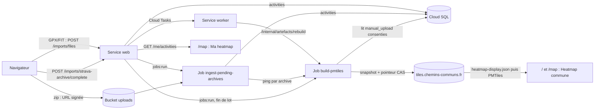

# Architecture

Vue d'ensemble de ce qui tourne aujourd'hui (pipeline **raw-trace**). Chaque
affirmation renvoie au code ; en cas de désaccord, le code a raison.

## Services et jobs (prod, GCP `europe-west1`)

Une seule image Docker (`backend/`, export statique Next.js intégré dans
`backend/static-frontend`) sert deux services Cloud Run et six jobs —
`scripts/deploy-prod.sh`.

| Composant | Taille | Rôle |
|---|---|---|
| `common-trails-api-prod` (**web**) | 512Mi, min=1, max=1 | Frontend statique + API légère : auth (lien magique), `/imports/*`, OAuth Strava, `/me/*`, `/export/*` |
| `common-trails-worker-prod` (**worker**) | 2Gi, min=0 | Handlers Cloud Tasks lourds : `/internal/ingest/heat`, `/internal/artefacts/rebuild`, `/internal/strava/webhook-event` |
| Job `build-pmtiles` | 8Gi | Construit et publie la heatmap commune (`backend/app/jobs/build_pmtiles.py`) |
| Job `ingest-pending-archives` | 8Gi | Draine les archives uploadées (`backend/app/jobs/ingest_pending_archives.py`) |
| Jobs `import-strava`, `resync-strava`, `strava-subscribe` | 512Mi | Synchro Strava (données **personnelles** uniquement) |
| Job `resync-reminder` | 512Mi | Email de rappel mensuel aux contributeurs inactifs |
| Cloud SQL `common-trails-prod` | db-f1-micro | Postgres 17 + PostGIS |
| Bucket `common-trails-heatmap-prod` | — | PMTiles, pointeur, raster, GeoJSONL ; servi derrière CDN sur `https://tiles.chemins-communs.fr` |
| Bucket uploads (`UPLOADS_BUCKET`) | — | Archives `.zip` envoyées par URL signée |

En dev, `docker-compose.yml` lance `db` (5487), `backend` (8787) et `frontend`
(3787, export statique servi par `frontend/serve.py`).

## Flux de données

1. **Upload.** Petits fichiers : `POST /imports/files`
   (`backend/app/api/imports.py`), un fichier par requête, stocké dans
   `activities` avec `source='manual_upload'`. Archives : `init` → upload direct
   GCS par URL signée → `complete`, qui déclenche le job de drain
   (`run_jobs.trigger_ingest_archives_job`).
2. **Drain.** Le job lit l'archive en streaming et crée les activités. Pour
   chaque archive qui contribue, il demande un build **avant** l'email « archive
   importée » (`_ArchiveRebuildPinger`, intervalle `DRAIN_PMTILES_REPING_S`).
3. **Build.** `build_pmtiles` (mode raw) lit les activités `manual_upload`
   consenties, masque les extrémités (`TRACE_MASK_METERS`, 200 m), applique le
   plancher `HEATMAP_MIN_USERS`, produit les couches `trails` + `heat_points`
   via tippecanoe, plus la pyramide raster et le GeoJSONL d'export.
4. **Publication + pointeur.** Snapshot immuable
   `heatmap-display-<version>.pmtiles` → pointeur `heatmap-display.json` publié
   par **compare-and-set** sur `snapshot_started_at` → copie mutable → purge des
   anciens snapshots. Des builds concurrents sont sans danger : un build plus
   ancien ne remplace jamais un pointeur plus récent
   (`_publish_pointer_cas`). Détails :
   [`heatmap-pipeline.md`](heatmap-pipeline.md#pmtiles-versioning-convention-phase-3).
5. **Affichage.** `/` et `/map` résolvent l'URL PMTiles via le pointeur
   (`frontend/lib/cdn-cache.ts`) et dessinent les couches de
   `frontend/lib/community-heatmap-layers.ts`. **« Ma heatmap »** ne passe pas
   par les PMTiles : elle vient en direct de `GET /me/activities`
   (`backend/app/api/me_activities.py`), en cyan, immédiatement après l'import.

**Déclencheurs du build** — événementiels : fin de lot
`/imports/files` (anti-rafale `BUILD_PMTILES_DEBOUNCE_S`), drain d'archive,
tâche Cloud Tasks `artefact-rebuild` (worker), suppressions d'activité / fusion
de comptes. Filet de sécurité **hebdomadaire** seulement (samedi 11:00 heure de Paris,
scheduler `common-trails-rebuild-pmtiles-daily-prod`, horaire asserté par
`scripts/deploy-prod.sh` ; un build quotidien coûtait trop cher) : un
déclenchement manqué peut laisser la carte en retard jusqu'à une semaine
([`runbooks/heatmap-rebuild.md`](runbooks/heatmap-rebuild.md)).

## Confidentialité

Seules les traces `manual_upload` consenties (`backend/app/services/provenance.py`)
alimentent la carte commune ; les activités synchronisées via l'API Strava
restent personnelles. Extrémités masquées (`TRACE_MASK_METERS`, 200 m) et
plancher `HEATMAP_MIN_USERS` (K = 1 pendant la bêta). Modèle complet :
[`privacy-model.md`](privacy-model.md).

## Déploiement

Merge sur `main` → `deploy-gcp.yml` → `scripts/deploy-prod.sh` (gcloud, pas de
terraform). Voir [`ci.md`](ci.md), [`prod-deploy.md`](prod-deploy.md) et
[`configuration.md`](configuration.md).

## Hérité / gelé

Le pipeline matched (map-matching OSM → `heat_edges` → agrégat), le routeur
WASM et le modèle social (routes, collections, forks) sont retirés ou gelés.
Leur documentation est dans [`archive/`](archive/).
